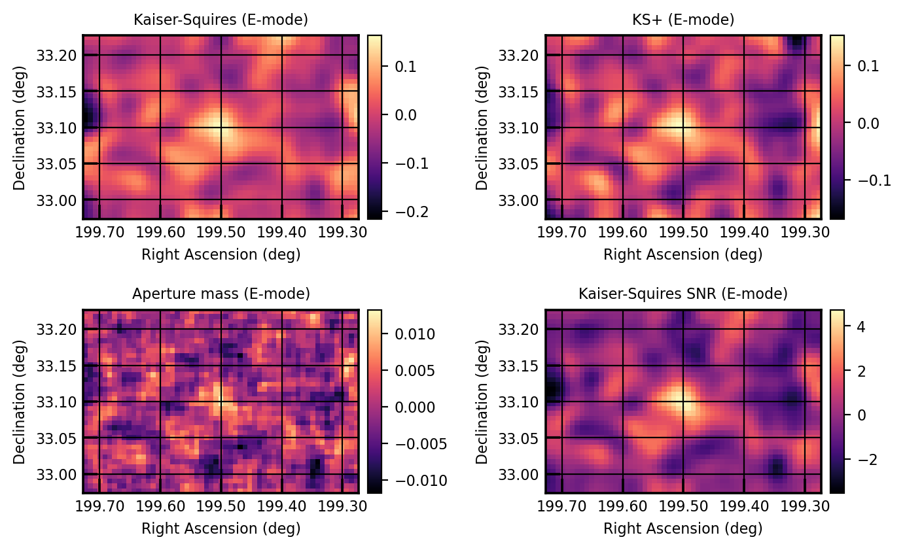

Overview
========

         galaxy cluster
   :align: center
   :width: 100%

**SMPy (Shear Mapping in Python)** transforms weak lensing shear catalogs into convergence maps— potentially revealing the invisible dark matter distribution in galaxy clusters and cosmic structures. While mass mapping is essential for modern cosmology, researchers often implement these algorithms from scratch. SMPy provides a standardized, accessible, and robust solution with multiple reconstruction methods (Kaiser-Squires, aperture mass, Euclid's KS+), flexible coordinate handling (celestial or pixel), and built-in statistical analysis. Originally developed for SuperBIT observations, it now serves as a general-purpose toolkit that makes publication-quality mass mapping as simple as writing a YAML configuration file.

Quickstart
----------

See :doc:`installation` for setup.

CLI (example config)::

   smpy -c examples/configs/example_config.yaml

Python API (3 lines)::

   import smpy
   result = smpy.map_kaiser_squires('examples/data/forecast_lum_annular.fits', pixel_scale=0.4,
                                    g1_col='g1_Rinv', g2_col='g2_Rinv', weight_col='weight')
   fig, ax, im = result.plot('E')

Expected inputs: a FITS catalog with shear components ``g1`` and ``g2`` (optional ``weight`` column), and coordinates in either RA/Dec (``radec``) or pixel (``pixel``) form.

Units: for RA/Dec, set ``pixel_scale`` in arcminutes per pixel; for pixel coordinates, provide a ``downsample_factor``. The Python functions return a `smpy.MassMap` (E- and B-mode maps, optional SNR maps, galaxy counts) and write nothing; ``smpy -c`` and `smpy.run` write the configured plots and FITS files under ``<output_directory>/<method>/``. For a full walkthrough, see :doc:`tutorials`.

Methods at a glance
-------------------

- Kaiser–Squires (KS): the seminal inversion from shear to convergence; establishes a fast baseline (`Kaiser & Squires, 1993 <https://ui.adsabs.harvard.edu/abs/1993ApJ...404..441K/abstract>`_).
- KS+: an enhancement of KS that mitigates missing data and border effects and supports reduced-shear iterations (`Pires et al., 2020 <https://www.aanda.org/articles/aa/abs/2020/06/aa36865-19/aa36865-19.html>`_).
- Aperture Mass: localized mass mapping via tangential-shear filters (e.g., Schirmer/Schneider), useful for peak detection and compact structures.

What SMPy includes
------------------

- Multiple methods (KS, KS+, Aperture Mass) for side-by-side comparison on the same data
- Coordinate flexibility (RA/Dec or pixel) with automatic handling and gridding
- Outputs: E/B-mode maps (B as a systematics diagnostic), optional SNR maps, plotting utilities, and optional FITS export for downstream use

Next steps: :doc:`tutorials`, :doc:`config`, :doc:`api/high_level_interface`.