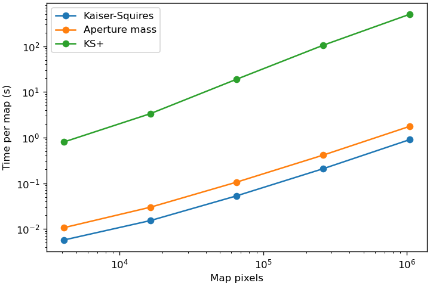

Performance
===========

The timings below are for `smpy.map_mass` with default settings, made by
``validation/performance.py`` on an Apple M4 Pro with Python 3.12, NumPy 2.2
and SciPy 1.15. Each catalog holds ten galaxies of pure shape noise per map
pixel, in pixel coordinates, and each time includes binning the catalog.

.. list-table::
   :header-rows: 1

   * - Map
     - Galaxies
     - Kaiser-Squires
     - Aperture mass
     - KS+
   * - 64 x 64
     - 40,960
     - 0.006 s
     - 0.011 s
     - 0.8 s
   * - 128 x 128
     - 163,840
     - 0.015 s
     - 0.030 s
     - 3.4 s
   * - 256 x 256
     - 655,360
     - 0.053 s
     - 0.11 s
     - 19 s
   * - 512 x 512
     - 2,621,440
     - 0.21 s
     - 0.41 s
     - 106 s
   * - 1024 x 1024
     - 10,485,760
     - 0.90 s
     - 1.8 s
     - 506 s

On the cluster field of the example catalog, a 57 x 38 map of 8,767 galaxies in
RA/Dec with weights, as in Figure 1 of the paper, a map takes 0.0042 s with
Kaiser-Squires, 0.0077 s with aperture mass and 0.70 s with KS+.

         methods, on logarithmic axes.

Kaiser-Squires and aperture mass take a time close to proportional to the
number of pixels and galaxies. Aperture mass convolves the shear with a kernel
of radius ``truncation * filter_scale``, so its time also grows with the square
of that radius.

KS+ runs ``inpainting_iterations`` iterations in each of its
``reduced_shear_iterations`` steps, 300 by default. Each iteration transforms
the map to and from the DCT and Fourier domains and takes two starlet
transforms, on a field padded to twice its size along each side. Its time is
proportional to the number of iterations and grows slightly faster than the
padded area.

Signal-to-noise maps
--------------------

An SNR map costs one shuffle, one binning and one map per shuffled catalog.
On the 256 x 256 map, each shuffle takes 0.076 s for Kaiser-Squires, 0.13 s
for aperture mass and 20 s for KS+. With the default 100 shuffles, a
Kaiser-Squires SNR map of 1024 x 1024 pixels therefore takes about two minutes,
and a KS+ SNR map about 14 hours.

KS+ SNR maps of large fields are the slow case. Their time is proportional to
``num_shuffles``, the number of pixels and the number of KS+ iterations. The
noise estimated from N shuffles has a relative uncertainty of about
1/sqrt(2(N - 1)): 7% for 100 shuffles and 10% for 50.

Memory
------

The SNR step holds one shuffled catalog at a time and the noise maps of
all shuffles, two maps per shuffle: 1.6 GB for 100 shuffles of a 1024 x 1024
map. KS+ also holds the starlet bands of its padded field.

JAX backend
-----------

The optional JAX backend bins shear and computes mass and signal-to-noise
maps with JAX. The first call for each method, grid shape and catalog size
compiles the kernels it needs. Later calls with matching settings reuse the
compiled code.

The timings below are for `smpy.map_mass` on XTX, a server with AMD EPYC 9455
processors and NVIDIA B200 GPUs. Each run was given 16 cores, and the GPU
run one B200. The runs used Python 3.12.3, NumPy 2.5.5, SciPy 1.18.1 and
JAX 0.12.1. All timings use float64, start with an in-memory table and end
with NumPy E and B maps. KS+ uses its default 100 inpainting iterations and
three reduced-shear iterations.

Each cell gives the median of three calls after the first, with the time of
the first call in parentheses. Times are in seconds. The first JAX call
includes compilation.

.. list-table::
   :header-rows: 1

   * - Catalog
     - Map
     - Method
     - NumPy
     - JAX on CPU
     - JAX on one B200
   * - Cluster, 8,767 galaxies
     - 57 x 38
     - Kaiser-Squires
     - 0.00606 (0.00804)
     - 0.00555 (0.248)
     - 0.00642 (0.885)
   * -
     -
     - Aperture mass
     - 0.00914 (0.0474)
     - 0.00561 (0.206)
     - 0.00622 (0.731)
   * -
     -
     - KS+
     - 0.712 (0.710)
     - 0.406 (1.06)
     - 0.137 (1.70)
   * - 5 x 5 degree field, 1,458,000 galaxies
     - 150 x 150
     - Kaiser-Squires
     - 0.120 (0.120)
     - 0.0549 (0.279)
     - 0.0354 (1.82)
   * -
     -
     - Aperture mass
     - 0.132 (0.132)
     - 0.0519 (0.342)
     - 0.0355 (1.80)
   * -
     -
     - KS+
     - 4.19 (4.22)
     - 3.64 (4.38)
     - 0.167 (2.90)
   * - 10 x 10 degree field, 10,800,000 galaxies
     - 300 x 300
     - Kaiser-Squires
     - 0.916 (0.916)
     - 0.487 (0.665)
     - 0.238 (1.58)
   * -
     -
     - Aperture mass
     - 0.957 (0.957)
     - 0.496 (0.634)
     - 0.239 (1.95)
   * -
     -
     - KS+
     - 19.7 (20.0)
     - 29.2 (30.1)
     - 0.448 (2.62)

On the B200, a repeated KS+ map is 5 times faster than NumPy on the cluster,
25 times on the 5 x 5 degree field and 44 times on the 10 x 10 degree field.
Kaiser-Squires and aperture mass gain close to a factor of four on the
largest catalog and little or nothing on the cluster. The first call on the
B200 takes 0.7 to 3 s, most of it compilation, so a single small map is
faster with NumPy.

The NumPy backend runs on one core: its times on one core and on 16 agree
within 3%. JAX on CPU uses every core it is given. On 16 cores it is about
twice as fast as NumPy for Kaiser-Squires and aperture mass on the two
fields. For KS+ it is 1.8 times faster on the cluster, 1.15 times faster on
the 5 x 5 degree field and 1.5 times slower on the 10 x 10 degree field.
Restricted to one core on the 5 x 5 degree field, JAX took 0.072 s for
Kaiser-Squires, 0.069 s for aperture mass and 15.1 s for KS+, where NumPy
took 4.3 s. Without a GPU, use the default NumPy backend for KS+.

A KS+ SNR map of the cluster with 20 orientation shuffles took 14.9 s with
NumPy, 8.60 s with JAX on CPU and 2.99 s with JAX on the B200. Each is one
call made after the maps above, which for JAX includes compiling the shuffle
loop. With the shear grid of the 10 x 10 degree field already on the B200,
a repeated KS+ call to `smpy.jax.ArrayMapper.map_grid` took 0.194 s. A
repeated call for the mean of the squared E and B maps and its gradient with
respect to both shear grids took 0.822 s.

The cluster is the bundled example FITS catalog. The two fields are seeded
mocks with shape noise, varying weights, masked holes and known shear modes.
Their sizes and galaxy densities follow the scales used in two Euclid
studies:

* 5 x 5 degrees with 16.2 galaxies per square arcminute, as in
  `Euclid preparation LXXXV <https://doi.org/10.1051/0004-6361/202557573>`_.
* 10 x 10 degrees with 30 galaxies per square arcminute, as in
  `Pires et al. (2020) <https://arxiv.org/abs/1910.03106>`_.

Run each command from the checkout root with the dependencies in
:doc:`installation`. The GPU run requires CUDA-enabled JAX.

.. code-block:: bash

   export PYTHONPATH=. OMP_NUM_THREADS=1 OPENBLAS_NUM_THREADS=1
   CUDA_VISIBLE_DEVICES="" taskset -c 0-15 python validation/jax_performance.py \
       --backend numpy --repeats 3 --output numpy.json
   CUDA_VISIBLE_DEVICES="" taskset -c 0-15 python validation/jax_performance.py \
       --backend jax-cpu --repeats 3 --output jax-cpu.json
   CUDA_VISIBLE_DEVICES=0 XLA_PYTHON_CLIENT_PREALLOCATE=false \
       taskset -c 32-47 python validation/jax_performance.py \
       --backend jax-gpu --repeats 3 --gradient --output jax-gpu.json

For the SNR timings, add ``--case cluster --snr-shuffles 20`` to each
command. For the one-core timings, use ``taskset -c 0`` and add
``--case euclid``, which selects the 5 x 5 degree field. Give each run its
own JSON output path.
