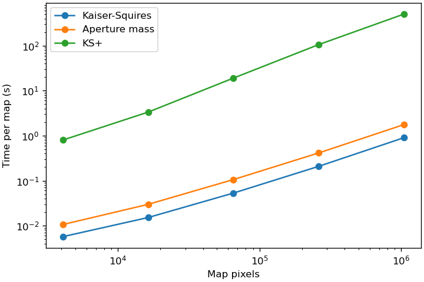

Performance
===========

The timings below are for `smpy.map_mass` with default settings, made by
``validation/performance.py`` on an Apple M4 Pro with Python 3.12, NumPy 2.2
and SciPy 1.15. Each catalogue holds ten galaxies of pure shape noise per map
pixel, in pixel coordinates, and each time includes binning the catalogue.

.. list-table::
   :header-rows: 1

   * - Map
     - Galaxies
     - Kaiser-Squires
     - Aperture mass
     - KS+
   * - 64 x 64
     - 40,960
     - 0.006 s
     - 0.011 s
     - 0.8 s
   * - 128 x 128
     - 163,840
     - 0.015 s
     - 0.030 s
     - 3.4 s
   * - 256 x 256
     - 655,360
     - 0.053 s
     - 0.11 s
     - 19 s
   * - 512 x 512
     - 2,621,440
     - 0.21 s
     - 0.41 s
     - 106 s
   * - 1024 x 1024
     - 10,485,760
     - 0.90 s
     - 1.8 s
     - 506 s

         methods, on logarithmic axes.

Kaiser-Squires and aperture mass take a time close to proportional to the
number of pixels and galaxies. Aperture mass convolves the shear with a kernel
of radius ``truncation * filter_scale``, so its time also grows with the square
of that radius.

KS+ runs ``inpainting_iterations`` iterations in each of its
``reduced_shear_iterations`` steps, 300 by default. Each iteration transforms
the map to and from the DCT and Fourier domains and takes two starlet
transforms, on a field padded to twice its size along each side. Its time is
proportional to the number of iterations and grows slightly faster than the
padded area.

Signal-to-noise maps
--------------------

An SNR map costs one shuffle, one binning and one map per shuffled catalogue.
On the 256 x 256 map, each shuffle takes 0.076 s for Kaiser-Squires, 0.13 s
for aperture mass and 20 s for KS+. With the default 100 shuffles, a
Kaiser-Squires SNR map of 1024 x 1024 pixels therefore takes about two minutes,
and a KS+ SNR map about 14 hours.

KS+ SNR maps of large fields are the slow case. Their time is proportional to
``num_shuffles``, the number of pixels and the number of KS+ iterations. The
noise estimated from N shuffles has a relative uncertainty of about
1/sqrt(2(N - 1)): 7% for 100 shuffles and 10% for 50.

Memory
------

The SNR step holds one shuffled catalogue at a time and the noise maps of
all shuffles, two maps per shuffle: 1.6 GB for 100 shuffles of a 1024 x 1024
map. KS+ also holds the starlet bands of its padded field.
