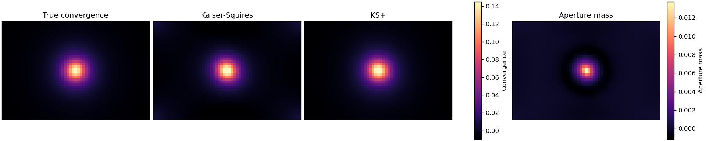
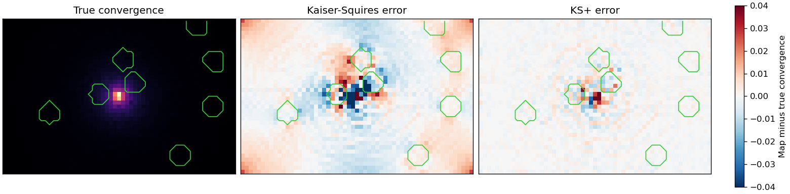
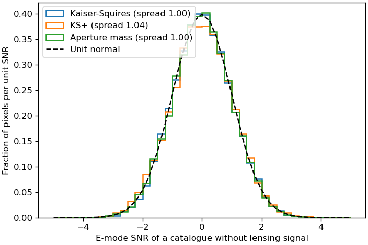

Validation
==========

SMPy's maps are checked against answers known independently of SMPy: exact
algebra, the known effect of transforming a catalog, and simulated catalogs
whose true convergence is known. The checks run as tests on every change, and
``validation/accuracy.py`` makes the figures and numbers on this page.

What the tests check
--------------------

``tests/test_physics.py`` holds the physics checks:

.. list-table::
   :header-rows: 1
   :widths: 35 65

   * - Check
     - Independent answer
   * - Kaiser-Squires relations
     - The shear of a convergence map matches the textbook Fourier relation
       exactly, and inverting it returns the convergence, on odd and even
       grids.
   * - Rotation
     - Turning every shear by an angle turns E + iB by twice that angle for
       Kaiser-Squires and aperture mass, and for KS+ without its reduced-shear
       correction and wavelet constraint, which treat E and B separately.
   * - Cluster recovery
     - Each method finds the NFW cluster of a noiseless simulated catalog
       where it is, with little B mode, in RA/Dec and in pixel coordinates.
   * - KS+ inpainting
     - Inside a hole, KS+ recovers a field of a few Fourier modes as
       Kaiser-Squires does from the complete shear, and it beats
       Kaiser-Squires inside holes cut in the simulated catalog.
   * - Starlet transform
     - The inverse transform restores the image to rounding error.
   * - Aperture mass
     - A constant shear has no aperture mass, and shears beyond the aperture
       radius add nothing.
   * - Sky projection
     - Tangential shear around a lens 4.7 degrees from the center of a
       12-degree field maps to E with almost no B, and the FITS WCS puts
       every galaxy in the pixel it was binned into.
   * - SNR
     - The noise behind an aperture-mass SNR map equals the exact shape noise
       of each pixel, and KS+ gives the Kaiser-Squires SNR where their maps
       agree.

``tests/test_reference.py`` also compares every output with stored results, so
any change to the numbers is deliberate.

Recovering a simulated cluster
------------------------------

The truth catalog in ``examples/data/forecast_lum_truth.fits`` holds the
noiseless reduced shear and magnification of an NFW cluster at the positions
of 34,704 galaxies, from which its convergence follows. The maps use 0.4
arcminute pixels and the default settings, and they are compared with the true
convergence averaged over each pixel and smoothed like the maps. Shear does not
determine the mean convergence, so every map is shown and compared with its
mean removed.

         Kaiser-Squires, KS+ and aperture-mass maps of its shear.

.. list-table::
   :header-rows: 1

   * - Method
     - Correlation with the truth
     - RMS error (peak 0.107)
     - B-mode / E-mode spread
   * - Kaiser-Squires
     - 0.965
     - 0.0042
     - 0.166
   * - KS+
     - 0.997
     - 0.0021
     - 0.025
   * - Aperture mass
     -
     -
     - 0.103

All three maps peak within one pixel of the true peak. By correcting for
reduced shear and the field border, KS+ halves the error of Kaiser-Squires and
cuts its B mode by a factor of 6.6. Aperture mass is a filtered statistic, not a
convergence map, so it is compared only by its peak and B mode.

Filling holes
-------------

Masks around bright stars leave holes in real catalogs. Here every galaxy
within 1.2 arcminutes of eight random points gets zero weight, and the maps,
unsmoothed, are compared with the true convergence. Green lines outline the
holes.

         Kaiser-Squires and KS+ maps.

Inside the holes, the RMS error is 0.0103 for Kaiser-Squires and 0.0064 for
KS+. KS+ also removes the Kaiser-Squires errors along the field border.

Calibration of the SNR maps
---------------------------

Turning every shear of the example catalog by a random angle removes its
lensing signal and keeps its noise, so the SNR map of such a catalog should
have zero mean and unit spread. The histogram pools the E-mode SNR maps of ten
such catalogs, each with 100 shuffles.

         three methods, matching a unit normal distribution.

The pooled spread is 1.00 for Kaiser-Squires, 1.04 for KS+ and 1.00 for
aperture mass; with 100 shuffles the expected spread is 1.01. Between
catalogs, the spread of a single map scatters by 5% to 14%, as neighboring
pixels are correlated, so one map alone is a poor check.
